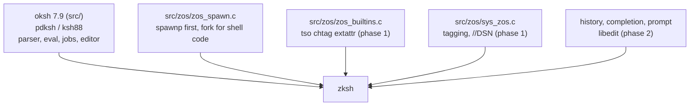

# zksh documentation

These documents describe the shell as it stands. They are the
project's working memory: when the design changes, the document
changes in the same commit as the code. Parts not built yet are
marked **planned**.

| Document | Covers | State |
| -------- | ------ | ----- |
| [direction.md](direction.md) | the constitution: three rules, lineage, what is refused | decided |
| [status.md](status.md) | what works today, what is next | living |
| [language.md](language.md) | the closed language set, verified against the build | living |
| [budget.md](budget.md) | enforced size, build, binary and runtime budgets | living |
| [build.md](build.md) | CMake and Ninja on both hosts, options, what replaced oksh's configure | living |
| [merge.md](merge.md) | what came from oksh, zash and FreeBSD ash, and why | living |
| [zos-changes.md](zos-changes.md) | the z/OS builtins and dialect | mostly planned |
| [compat.md](compat.md) | differences from the z/OS `sh` | living |
| [port.md](port.md) | every edit to the oksh base | living |

## Shape

## What zksh is not

Not AT&T ksh88 (the UCS/DFKSH shell behind z/OS `/bin/sh`), not
ksh93, not bash, not a POSIX-only shell. Those distinctions are
decision-relevant and are argued in [direction.md](direction.md).
